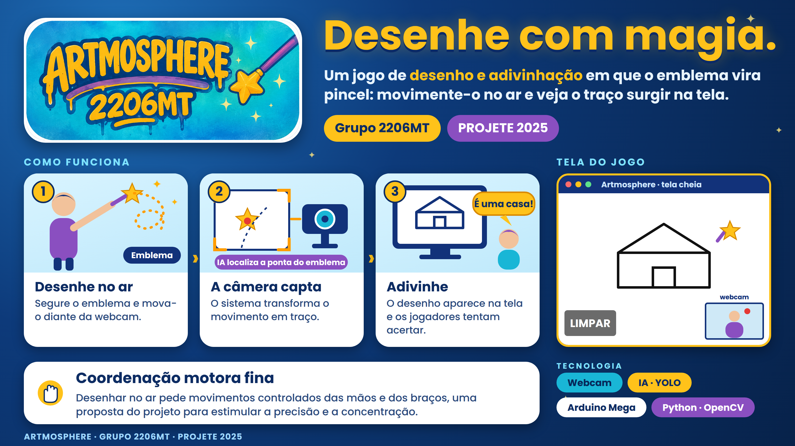
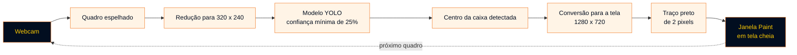
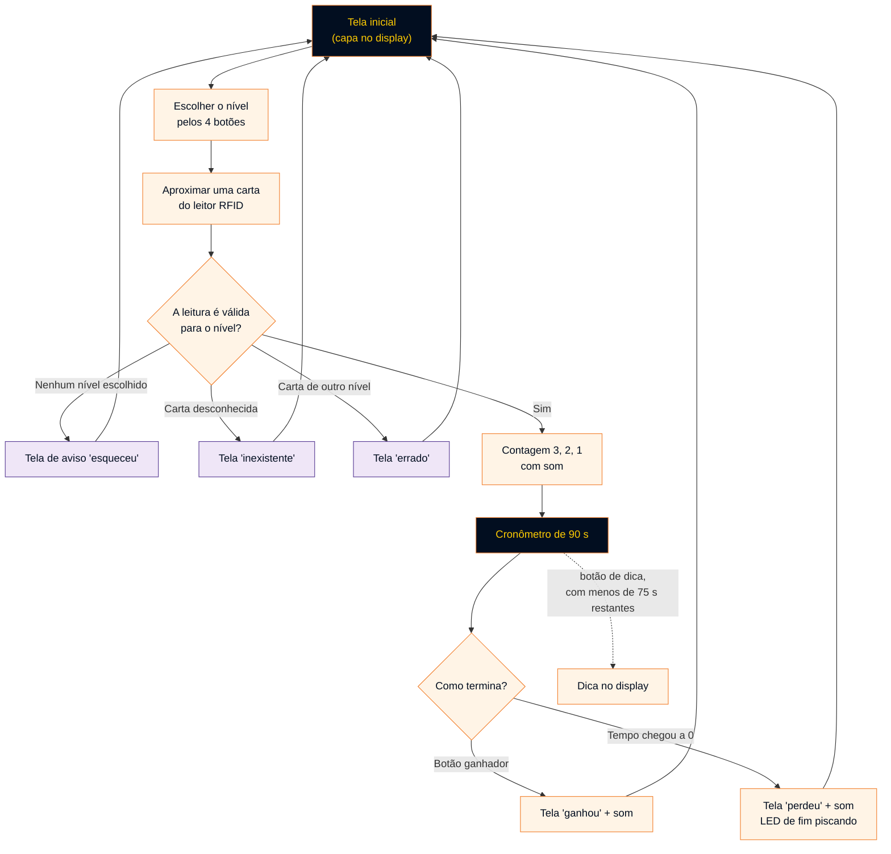
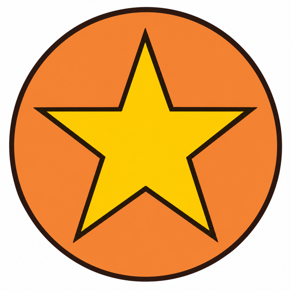

<p align="center">
  
</p>

<p align="center">
  Uma varinha mágica, uma webcam e inteligência artificial para transformar movimento em desenho.<br>
  Um projeto <strong>Artmosphere 2206MT</strong>, desenvolvido para a <strong>PROJETE 2025</strong>.
</p>

<p align="center">
  
  
  
  
  
</p>

<p align="center">
  <a href="#projeto">Conheça o Artmosphere</a> ·
  <a href="#software">Veja o software</a> ·
  <a href="#hardware">Explore o protótipo físico</a> ·
  <a href="#instalacao">Coloque para funcionar</a> ·
  <a href="#estrutura">Navegue pelo código</a>
</p>

---

<a id="projeto"></a>

## Uma ideia para transformar movimento em desenho

O Artmosphere foi criado para contribuir com um desafio: tornar a experiência de desenhar mais interativa e acessível, incentivando a prática de movimentos precisos de um jeito lúdico. Em vez de depender de papel ou de uma tela sensível ao toque, a pessoa desenha movimentando uma varinha no ar. A proposta é estimular a **coordenação motora fina**, a concentração, a percepção espacial e a criatividade, com possibilidades de uso em atividades educacionais e inclusivas.

O projeto combina **visão computacional, inteligência artificial, programação e eletrônica** para transformar o movimento real em um traço digital.

> **O emblema é essencial para desenhar.** Ele precisa aparecer na imagem capturada pela webcam para que o modelo de inteligência artificial consiga reconhecê-lo. Quando o emblema está visível e é detectado, o programa acompanha sua posição e transforma o movimento em desenho. Se ele não aparecer corretamente na câmera, o sistema pode não conseguir desenhar.

### O que o repositório reúne

| Parte                  | O que é                                                                                          | Onde está                                                  |
| ---------------------- | ------------------------------------------------------------------------------------------------ | ---------------------------------------------------------- |
| **Software de desenho** | Programa em Python que detecta a ponta da varinha pela webcam e desenha em tela cheia.           | [`Software/artmosphere/projete2206.py`](Software/artmosphere/projete2206.py) |
| **Modelo de detecção**  | Modelo YOLO treinado para reconhecer o marcador visual da varinha (`ponta_varinha`), chamado de emblema neste README.      | [`Software/artmosphere/best (4).pt`](Software/artmosphere/best%20%284%29.pt) |
| **Protótipo físico**    | Firmware Arduino Mega que controla RFID, display gráfico, LEDs, botões, cronômetro e áudio.      | [`Hardware/Hardware.ino`](Hardware/Hardware.ino)           |
| **Guia de execução**    | Documento da equipe sobre como colocar a programação para funcionar.                             | [`Software/artmosphere/rodar_programacao.pdf`](Software/artmosphere/rodar_programacao.pdf) |

> **Importante:** o software de desenho e o protótipo físico são **executados de forma independente**. Os arquivos do repositório não contêm comunicação entre o programa Python e o Arduino.

<a id="software"></a>

## Como funciona

O programa abre a webcam, espelha a imagem e, a cada quadro, pede ao modelo YOLO que reconheça o emblema da varinha. **Mantenha o emblema visível dentro do campo de visão da câmera:** é ele que permite ao sistema localizar a varinha. O centro da área detectada vira um ponto na tela, e os pontos consecutivos são ligados para formar o desenho.



### O que acontece em cada etapa

| Etapa                       | O que o código faz                                                                                                                             |
| --------------------------- | ---------------------------------------------------------------------------------------------------------------------------------------------- |
| **1 · Capturar**            | Lê um quadro da webcam e o espelha na horizontal, como em um espelho.                                                                          |
| **2 · Detectar**            | Reduz o quadro para 320 × 240 e executa o modelo com confiança mínima de 0,25. Se houver mais de uma detecção, usa a primeira caixa retornada. |
| **3 · Converter**           | Calcula o centro da caixa e o converte para as coordenadas da tela de desenho de 1280 × 720.                                                   |
| **4 · Desenhar**            | Liga os pontos sucessivos com linhas pretas de 2 pixels. Se a detecção falha, mantém a última posição por até 5 quadros antes de encerrar o traço. |
| **5 · Limpar**              | Quando a ponta toca o botão virtual **LIMPAR**, o desenho é apagado. Há um intervalo mínimo de 0,5 s entre duas limpezas.                       |
| **6 · Exibir**              | Mostra tudo em uma janela de tela cheia chamada `Paint`, com a miniatura da webcam no canto inferior direito e um marcador sobre o emblema detectado. |

Pressione **Q** a qualquer momento para encerrar o programa.

### A tela do Artmosphere

| Elemento                    | Detalhe (conforme o código)                                                  |
| --------------------------- | ---------------------------------------------------------------------------- |
| **Área de desenho**         | Fundo branco de 1280 × 720 pixels, em janela de tela cheia.                   |
| **Botão LIMPAR**            | Retângulo cinza com texto branco, no **canto inferior esquerdo** da tela.     |
| **Miniatura da webcam**     | Imagem de 240 × 180 pixels no **canto inferior direito**.                     |
| **Marcador de detecção**    | Ponto que indica a posição reconhecida na miniatura da webcam.                 |

<a id="hardware"></a>

## O protótipo físico

Além do software, o projeto conta com um protótipo controlado por um **Arduino Mega**. O firmware está em um único arquivo, [`Hardware/Hardware.ino`](Hardware/Hardware.ino), e implementa uma dinâmica de **cartas com RFID, níveis de dificuldade, cronômetro de 90 segundos, dicas e áudio**. Cerca de 33 telas de 128 × 64 pixels (bitmaps) ficam armazenadas no próprio código, e por isso o arquivo é extenso.

### Componentes e pinos usados no firmware

| Componente                         | Função no protótipo                                                         | Conexão no código                                          |
| ---------------------------------- | --------------------------------------------------------------------------- | ---------------------------------------------------------- |
| **Arduino Mega**                   | Controlador central do protótipo.                                           | Usa as portas seriais `Serial2` e `Serial3`.               |
| **Leitor RFID RDM6300**            | Lê as cartas (tags) e as identifica.                                        | `Serial3`, a 9600 bauds.                                   |
| **Display gráfico KS0108 (128 × 64)** | Exibe a tela inicial, as dicas e os avisos.                              | Pinos 22 a 29 (D0–D7), 34 (EN), 30 (CS1), 31 (CS2), 32 (DI), 33 (RW). |
| **4 botões de nível**              | Selecionam o nível de dificuldade.                                          | Pinos 53, 51, 49 e 47.                                     |
| **4 LEDs de nível**                | Indicam o nível selecionado: branco, verde, amarelo e vermelho.             | Pinos 52, 50, 48 e 46.                                     |
| **LED RGB**                        | Acionado nas respostas às leituras das cartas.                              | Pinos 10 (R), 11 (G) e 12 (B).                             |
| **Display de 2 dígitos (BCD)**       | Mostram a contagem regressiva e o cronômetro.                              | Dezena: pinos 6, 7, 8 e 9. Unidade: pinos 2, 3, 4 e 5.     |
| **Botão de dica e LED de leitura** | Pedem a dica da carta lida; o LED acende quando uma tag é lida.             | Botão no pino 45; LED no pino 44.                          |
| **Botão ganhador e LED de fim**    | Encerram a rodada com vitória; o LED sinaliza o fim da rodada.              | Botão no pino 41; LED no pino 40.                          |
| **DFPlayer Mini**                  | Toca os sons da contagem, da vitória e do fim do tempo.                     | `Serial2`, a 9600 bauds; volume 30.                        |

O repositório não inclui o esquema elétrico da montagem. A tabela acima reflete a pinagem declarada no firmware.

### A rodada, passo a passo



- **Níveis.** O firmware organiza **32 cartas em 4 níveis de 8 cartas** (branco, verde, amarelo e vermelho). Cada carta só é aceita no nível a que pertence.
- **Dicas.** Antes de restarem menos de 75 segundos, o botão de dica mostra uma tela de dica indisponível. Depois disso, o display mostra uma imagem ou a indicação do número de letras, conforme a carta lida.
- **Som.** O DFPlayer Mini reproduz a faixa **3** na contagem inicial, a faixa **2** na vitória e a faixa **1** quando o tempo acaba.

<details>
<summary><strong>Cartas de cada nível, como definidas no firmware</strong></summary>

| Nível        | Cartas                                                                                       |
| ------------ | -------------------------------------------------------------------------------------------- |
| **Branco**   | casa, cachorro, flor, pizza, sorvete, lápis, cama, pato                                      |
| **Verde**    | mochila, sushi, médico, bombeiro, dentista, coruja, pintor, telescópio                       |
| **Amarelo**  | cientista, croissant, jacaré, tamanduá, escorregador, hélice, mágico, estetoscópio           |
| **Vermelho** | axolote, astrônomo, narval, torta de limão, cuscuz, anêmona, planetário, seu adversário      |

Os identificadores das tags estão declarados no próprio firmware. Para usar outras tags RFID, é preciso editar esses identificadores no código.

</details>

## Demonstração visual

<p align="center">
  
</p>

<p align="center"><sub>O emblema é o marcador visual que a webcam precisa reconhecer para permitir o desenho.</sub></p>

**Como usar:** coloque o emblema diante da webcam e mantenha-o visível. O programa detecta sua posição; ao mover a varinha, o traço acompanha o movimento. O emblema não é apenas decorativo: ele é a referência visual necessária para desenhar.

## Tecnologias com uma função definida

| Camada                    | Tecnologia                          | Papel no Artmosphere                                                   |
| ------------------------- | ----------------------------------- | ---------------------------------------------------------------------- |
| **Linguagem do software** | Python                              | Lógica de desenho, traços e botão LIMPAR.                              |
| **Imagem e interface**    | OpenCV (`opencv-python`)            | Captura da webcam, janela em tela cheia e desenho dos traços.          |
| **Detecção**              | Ultralytics YOLO (`ultralytics`)    | Execução do modelo `best (4).pt`, treinado para a ponta da varinha.    |
| **Cálculos**              | NumPy (`numpy`)                     | Tela de desenho como matriz de pixels.                                 |
| **Firmware**              | Arduino (C++) e Arduino Mega        | Controle do protótipo físico.                                          |
| **Display gráfico**       | Biblioteca U8glib                   | Exibição das telas no display KS0108.                                  |
| **RFID**                  | Biblioteca RDM6300                  | Leitura das tags pelo módulo RDM6300.                                  |
| **Áudio**                 | Biblioteca DFRobotDFPlayerMini      | Reprodução dos sons pelo DFPlayer Mini.                                |

O modelo `best (4).pt` contém metadados que indicam uma arquitetura **YOLOv8** com uma única classe, `ponta_varinha`. Na prática, essa classe representa o emblema que deve aparecer na webcam para que o desenho funcione.

<a id="instalacao"></a>

## Coloque o Artmosphere para funcionar

<details>
<summary><strong>Mostrar ou ocultar as instruções de instalação e execução</strong></summary>

<br>

O ambiente documentado pela equipe e refletido no código é o **Windows**: o programa usa o modo de captura `CAP_DSHOW`, do Windows, e o guia de execução cita o Prompt de Comando e o IDLE (Python 3.12, 64 bits). Em outros sistemas, o código precisaria de ajustes, que não foram verificados.

### 1. Prepare o computador

| Necessário                  | Preparação                                                                                         |
| --------------------------- | -------------------------------------------------------------------------------------------------- |
| **Python 3 e pip**          | O desenvolvimento usou o Python 3.12 (64 bits). O repositório não define uma versão mínima.         |
| **Webcam**                  | Integrada ou USB, sem uso por outro programa.                                                      |
| **Um editor ou o terminal** | IDLE, VS Code, PyCharm ou o Prompt de Comando.                                                     |
| **Repositório**             | Baixe os arquivos (**Code → Download ZIP**) ou clone o repositório e abra a pasta `Artmosphere_2K25`. |

O guia da equipe alerta que **ambientes online** podem não funcionar bem, porque o acesso à webcam pode ser bloqueado por permissões.

### 2. Instale as bibliotecas

No Prompt de Comando:

```bash
pip install opencv-python numpy ultralytics
```

O código importa quatro bibliotecas (`cv2`, `numpy`, `time` e `ultralytics`); só as três acima precisam ser instaladas. A instalação do `ultralytics` pode baixar dependências grandes, como o PyTorch.

### 3. Aponte o programa para o modelo

O arquivo [`projete2206.py`](Software/artmosphere/projete2206.py) traz, na **linha 7**, um caminho completo do computador em que o projeto foi desenvolvido. É preciso trocá-lo pelo caminho do modelo no **seu** computador:

```python
model = YOLO(r"C:\caminho\da\sua\pasta\Artmosphere_2K25\Software\artmosphere\best (4).pt")
```

Dica: no Explorador de Arquivos do Windows, clique com o botão direito em `best (4).pt` e escolha **Copiar como caminho**. Cole o resultado entre as aspas, mantendo o `r` antes delas.

### 4. Confira a câmera

A **linha 8** abre a webcam:

```python
cap = cv2.VideoCapture(0, cv2.CAP_DSHOW)
```

| Situação                                          | O que fazer                                                                                                  |
| ------------------------------------------------- | ------------------------------------------------------------------------------------------------------------ |
| **Abriu a câmera desejada**                       | Nenhuma alteração.                                                                                           |
| **Abriu a câmera errada ou o programa fechou logo** | Troque o `0` por `1` ou `2` e execute de novo, até encontrar a câmera certa. A numeração depende do computador. |
| **Nada aparece**                                  | Feche outros programas que usem a webcam e verifique as permissões de câmera do Windows.                      |

O comentário original dessa linha menciona o índice 1 para uma webcam USB, mas o valor atual no código é **0**. Qual índice funciona depende dos dispositivos conectados a cada computador. Se a câmera não puder ser lida, o programa simplesmente encerra, sem mensagem de erro.

### 5. Execute

Pelo Prompt de Comando, dentro da pasta do software:

```bash
cd Software\artmosphere
python projete2206.py
```

Ou abra `projete2206.py` no IDLE e use **Run → Run Module** (F5). Aponte a varinha para a câmera e garanta que o emblema esteja visível: a janela `Paint` abre em tela cheia, e o desenho aparece conforme o emblema é detectado. Para apagar, toque o botão **LIMPAR**. Para sair, pressione **Q**.

### 6. Protótipo físico (opcional)

1. Instale a [Arduino IDE](https://www.arduino.cc/en/software).
2. Instale as bibliotecas usadas pelo firmware: **RDM6300**, **U8glib** e **DFRobotDFPlayerMini**.
3. Abra [`Hardware/Hardware.ino`](Hardware/Hardware.ino), selecione a placa **Arduino Mega** e a porta correta, e envie o código.
4. Monte os componentes conforme a pinagem da [tabela do protótipo](#hardware).

O firmware chama as faixas de áudio **1**, **2** e **3** do DFPlayer Mini; os arquivos de som não fazem parte do repositório. Se o DFPlayer não for inicializado, o firmware interrompe a execução e escreve uma mensagem de erro no monitor serial. O funcionamento físico depende da montagem, das conexões elétricas e da alimentação correta dos componentes.

### Se algo não funcionar: verificações por sintoma

| Sintoma                                      | O que conferir                                                                                          |
| -------------------------------------------- | ------------------------------------------------------------------------------------------------------- |
| `ModuleNotFoundError` ao executar            | Confirme a instalação com `pip install opencv-python numpy ultralytics` no mesmo Python que executa o programa. |
| Erro de arquivo não encontrado para o modelo | Revise o caminho da linha 7, incluindo o nome `best (4).pt`.                                             |
| O programa abre e fecha imediatamente        | A webcam não foi lida: ajuste o índice da câmera (linha 8) e feche outros programas que a usem.         |
| O emblema não é detectado                    | Mantenha o emblema visível dentro do enquadramento, melhore a iluminação e evite ocultá-lo. O modelo usa confiança mínima de 0,25. |
| Os traços ficam saltados                     | A detecção perde a ponta por mais de 5 quadros seguidos, e o traço atual é encerrado.                   |
| Tela do Arduino sem imagem ou travada        | Confira a pinagem do display KS0108 e a alimentação do conjunto.                                        |
| Arduino interrompido na partida              | O DFPlayer Mini não inicializou: verifique a conexão em `Serial2` e o cartão de memória.                |

</details>

<a id="estrutura"></a>

## Explore o projeto por dentro

```text
Artmosphere_2K25/
├── README.md
├── Documentos/
│   └── readme/                          Imagens usadas neste README
│       ├── artmosphere-imagem-principal.png
│       ├── artmosphere-capa.png
│       ├── logo-artmosphere-2206mt.png
│       ├── emblema-artmosphere.png
│       ├── adesivo-artmosphere-2206mt.jpg
│       └── artmosphere-footer.svg                 Faixa animada do rodapé
├── Hardware/
│   └── Hardware.ino                     Firmware do Arduino Mega
└── Software/
    └── artmosphere/
        ├── projete2206.py               Programa principal (Python)
        ├── best (4).pt                  Modelo YOLO treinado
        └── rodar_programacao.pdf        Guia da equipe para executar o programa
```

### Onde consultar cada parte

| Quero entender…                             | Arquivo                                                                             |
| ------------------------------------------- | ----------------------------------------------------------------------------------- |
| **A detecção e o desenho**                  | [`projete2206.py`](Software/artmosphere/projete2206.py), com comentários em português. |
| **A geometria do botão LIMPAR**             | Funções `point_in_rect`, `segments_intersect` e `segment_intersects_rect`, no mesmo arquivo. |
| **As regras da rodada e o cronômetro**      | Funções `setup` e `loop` de [`Hardware.ino`](Hardware/Hardware.ino).                 |
| **O display de 2 dígitos (BCD)**                | Funções `atualizarDisplay` e `enviarBCD`, em `Hardware.ino`.                         |
| **Como executar o software**                | [Guia da equipe (PDF)](Software/artmosphere/rodar_programacao.pdf).                  |

### Limites desta versão

- O caminho do modelo está escrito diretamente no código e precisa ser ajustado em cada computador.
- A abertura da câmera usa `CAP_DSHOW`, específico do Windows, e o programa não exibe mensagem quando a webcam não abre.
- Apenas a **primeira** detecção de cada quadro é usada para desenhar; o programa não acompanha várias varinhas.
- O repositório não traz métricas de desempenho do modelo, testes automatizados ou esquema elétrico do protótipo.
- O programa Python e o firmware do Arduino não trocam dados entre si.

## Feito pela equipe Artmosphere

O Artmosphere foi desenvolvido para a **PROJETE 2025** e reúne programação, treinamento de um modelo de visão computacional, eletrônica e design de interação em uma proposta que une tecnologia, criatividade e inclusão.

| Projeto                  | Identificação |
| ------------------------ | ------------- |
| **Artmosphere**          | 2206MT        |

## 📄 Direitos autorais

© 2025–2026 Artmosphere. Todos os direitos reservados, respeitados os direitos dos demais autores e titulares envolvidos.

Este repositório é disponibilizado para fins de apresentação acadêmica, documentação e demonstração do projeto. A publicação do código e dos materiais neste repositório não concede autorização geral para copiar, modificar, redistribuir, comercializar ou reutilizar o projeto, sua identidade visual ou seus materiais autorais.

Para solicitar autorização de uso ou reprodução, entre em contato com os respectivos titulares dos direitos.

As bibliotecas, ferramentas e demais componentes de terceiros permanecem sujeitos às suas próprias licenças e condições de uso.

---

<p align="center">
  
</p>
